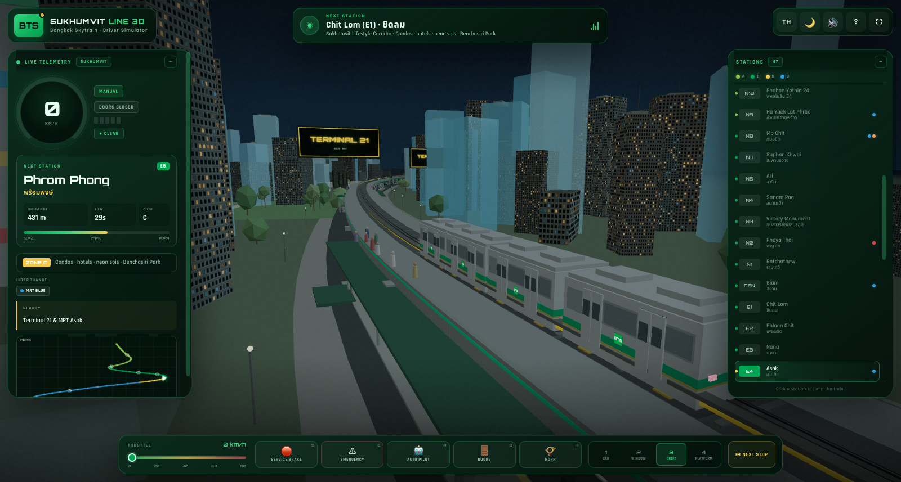
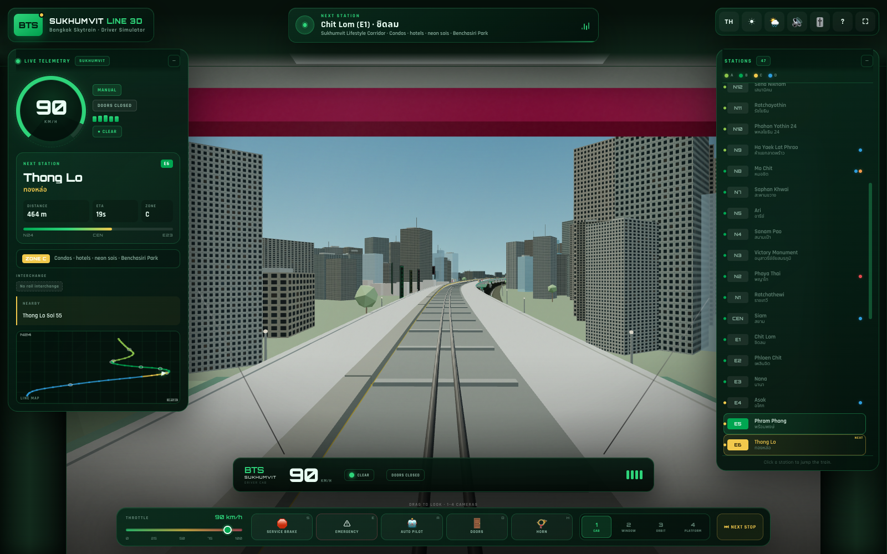
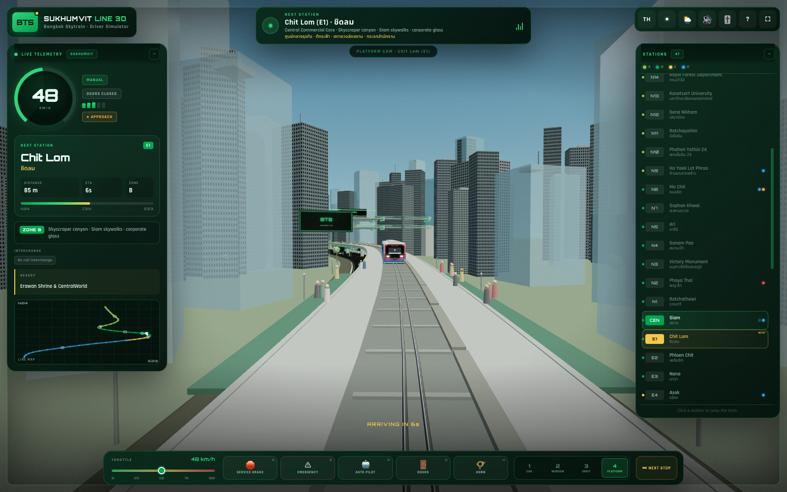
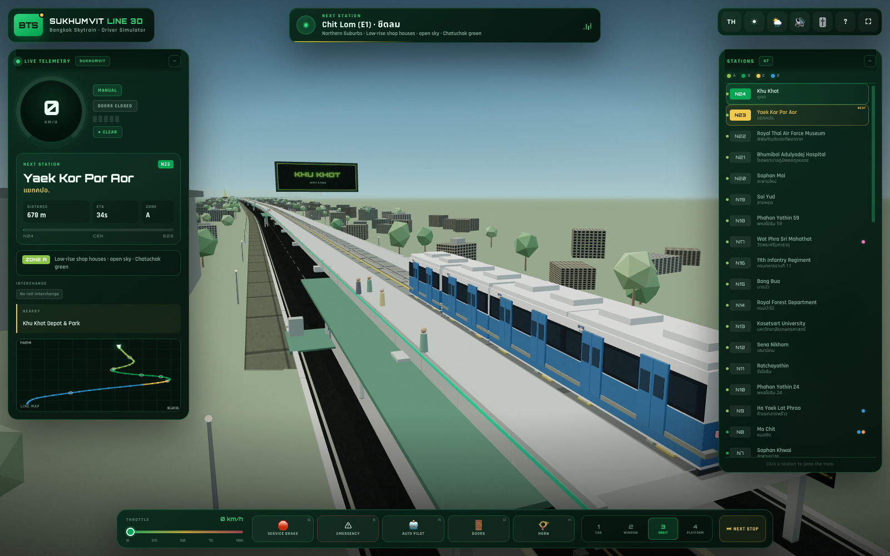
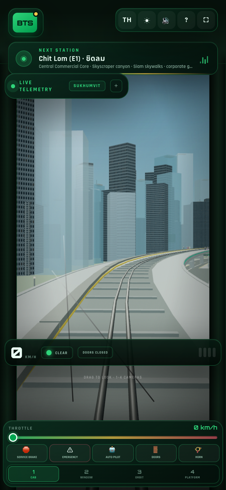
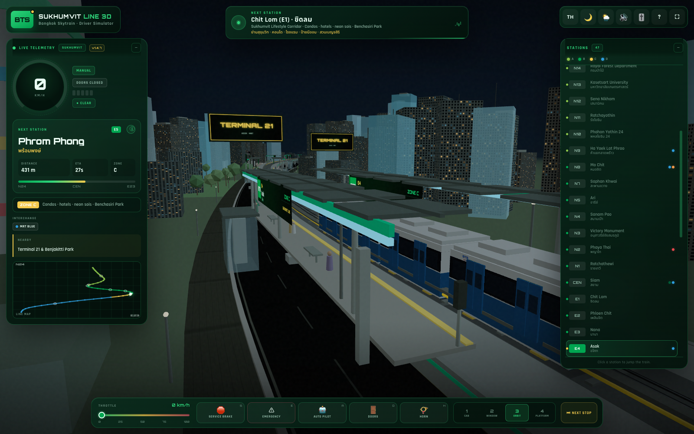
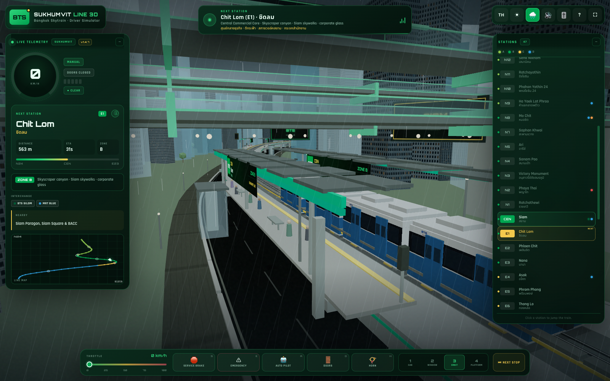

<div align="center">



# BTS SUKHUMVIT LINE 3D

**Authentic Bangkok City & Driver Simulator**

Drive a four-car Bangkok Skytrain along all **47 operational stations** of the Sukhumvit Line — from **Khu Khot (N24)** in the north to **Kheha (E23)** in Samut Prakan — through a procedurally built Bangkok of shop-house suburbs, the Siam skyscraper canyon, Sukhumvit neon and the southern delta.

[](https://somphol.github.io/bts-sukhumvit-line-3d/)
[](#verification)
[](#the-line)
[](LICENSE)

**[Play it live →](https://somphol.github.io/bts-sukhumvit-line-3d/)**

</div>

---

BTS Sukhumvit Line 3D is a complete, self-contained 3D browser simulator built with **vanilla HTML5, CSS3 and ES6 JavaScript**, rendered with **Three.js r128** and **OrbitControls**. There is no build step, no framework and no asset bundle. Every skyscraper, shop house, station, train car, sign, tree, passenger and English voice is generated in the browser; the Thai PA uses 145 bundled Kanya-voice clips under `audio/th/`.

The whole thing runs from three source files — `index.html`, `style.css` and `script.js`.

<div align="center">

<sub><b>Driver cab view</b> — live speed, next station, distance, ETA, zone and traction telemetry.</sub>
</div>

---

## Contents

- [The sim](#the-sim)
- [Four city zones](#four-city-zones)
- [The line](#the-line)
- [Cameras](#cameras)
- [Telemetry and bilingual HUD](#telemetry-and-bilingual-hud)
- [Train, doors and auto pilot](#train-doors-and-auto-pilot)
- [Audio](#audio)
- [Landmarks](#landmarks)
- [Controls](#controls)
- [Time of day](#time-of-day)
- [Rain and storm](#rain-and-storm)
- [Mobile](#mobile)
- [Run it locally](#run-it-locally)
- [Project structure](#project-structure)
- [Verification](#verification)
- [Credits](#credits)
- [License](#license)

---

## The sim

You board a **four-car BTS train** at either terminus — Khu Khot (N24) or Kheha (E23) — with auto pilot on by default and a one-click **TAKE MANUAL** takeover, then take control of an elevated third-rail railway. The free orbit camera (3) is the default view; press 1 for the driver cab. The route is a continuous, gently curving viaduct with two running rails, a glowing third rail, concrete piers, parapets, ballastless track, track-side signals and 47 side-platform stations with canopies, name boards, benches, lifts and waiting passengers.

The simulation keeps the **real station order, codes, Thai names, zone character and interchange information**, while compressing the 50+ km alignment into a playable route and scaling displayed distances. **N6 Sena Ruam**, an unopened infill station, is intentionally not included, which is why the operational count is 47.

The train is fully rail-guided: you control traction, service braking, emergency braking, doors and the auto pilot. A door interlock prevents traction while the doors are open, and the auto pilot can serve every platform, dwell, close the doors, depart, and reverse at either terminus.

<div align="center">

<sub><b>Platform arrival cam</b> — a fixed platform camera looks down the track as the train arrives.</sub>
</div>

---

## Four city zones

The procedural generator changes building density, height, palette, glass ratio, trees and landmarks by the active station zone.

| Zone | Stations | Character |
| --- | --- | --- |
| **A · Northern Suburbs** | N24 Khu Khot → N9 Ha Yaek Lat Phrao | Low-rise shop houses, open sky, wide suburban roads, dense trees around Chatuchak, the Khu Khot depot and Wat Phra Sri Mahathat. |
| **B · Central Commercial Core** | N8 Mo Chit → E3 Nana | Ultra-dense skyscraper canyon, corporate glass towers, Siam multi-level skywalks, billboard screens and the Victory Monument obelisk. |
| **C · Sukhumvit Lifestyle Corridor** | E4 Asok → E7 Ekkamai | High-rise condos and hotels, neon Soi signs, the Terminal 21 facade, Benchasiri Park and the Ekkamai bus terminal. |
| **D · Southern Industrial & Coastal Delta** | E8 Phra Khanong → E23 Kheha | Mid-rise residential giving way to warehouses, factories, a flat delta horizon, the Gulf coast and the Erawan Museum elephant. |

<div align="center">

<sub><b>Zone A</b> — Khu Khot: low-rise suburbs, trees and the depot billboard.</sub>
</div>

---

## The line

**47 operational stations · N24 Khu Khot ↔ E23 Kheha**

<details>
<summary><b>Zone A — Northern Suburbs (16 stations)</b></summary>

N24 Khu Khot · N23 Yaek Kor Por Aor · N22 Royal Thai Air Force Museum · N21 Bhumibol Adulyadej Hospital · N20 Saphan Mai · N19 Sai Yud · N18 Phahon Yothin 59 · N17 Wat Phra Sri Mahathat *(MRT Pink)* · N16 11th Infantry Regiment · N15 Bang Bua · N14 Royal Forest Department · N13 Kasetsart University · N12 Sena Nikhom · N11 Ratchayothin · N10 Phahon Yothin 24 · N9 Ha Yaek Lat Phrao *(MRT Blue)*

</details>

<details>
<summary><b>Zone B — Central Commercial Core (11 stations)</b></summary>

N8 Mo Chit *(MRT Blue · BRT)* · N7 Saphan Khwai · N5 Ari · N4 Sanam Pao · N3 Victory Monument · N2 Phaya Thai *(ARL)* · N1 Ratchathewi · CEN Siam *(BTS Silom · MRT Blue via skywalk)* · E1 Chit Lom · E2 Phloen Chit · E3 Nana

</details>

<details>
<summary><b>Zone C — Sukhumvit Lifestyle Corridor (4 stations)</b></summary>

E4 Asok *(MRT Blue)* · E5 Phrom Phong · E6 Thong Lo · E7 Ekkamai

</details>

<details>
<summary><b>Zone D — Southern Industrial & Coastal Delta (16 stations)</b></summary>

E8 Phra Khanong · E9 On Nut · E10 Bang Chak · E11 Punnawithi · E12 Udom Suk · E13 Bang Na · E14 Bearing · E15 Samrong *(MRT Yellow)* · E16 Pu Chao · E17 Chang Erawan · E18 Royal Thai Naval Academy · E19 Pak Nam · E20 Srinagarindra · E21 Phraek Sa · E22 Sai Luat · E23 Kheha

</details>

---

## Cameras

Switch with the HUD buttons or keys **1–4**.

| Key | View | Description |
| --- | --- | --- |
| **1** | **Driver cab** | First-person view from the lead car, looking down the viaduct. Windshield frame, wipers, dashboard speed gauge, signal lamp, door state and a live HTML cockpit overlay. Drag to look around. |
| **2** | **Passenger scenic window** | Side-window view from the second car, looking out and forward across the Bangkok skyline, street traffic and station canopies. |
| **3** | **Free orbit** | 360° external camera following the four-car train. Mouse or touch to orbit and zoom. |
| **4** | **Platform arrival cam** | Fixed camera on the next station platform, looking down the track as the train arrives, with ETA and platform name. |

<div align="center">

<sub><b>Mobile</b> — telemetry minimises on small screens and the control dock reflows.</sub>
</div>

---

## Telemetry and bilingual HUD

The HUD is a crisp transit overlay in BTS light green, dark green and gold.

- Live **speed** (km/h) with a conic speed ring and traction bars.
- **Next station** code, English name and Thai name.
- **Distance to next station** in metres or kilometres.
- **ETA** in seconds, calculated from the current speed or a braking estimate when stopped.
- **Active zone** with its description and colour.
- **Upcoming interchange** chips — MRT Blue, MRT Pink, MRT Yellow, ARL and BRT.
- **Nearby landmark** callout.
- **Route progress** and a live **line minimap** with zone-coloured segments and a train marker.
- **Station list** with all 47 stations; click any station to jump the train there.
- **Station information card** — station code, English/Thai names, zone, interchanges, nearby landmark, a direct **Google Maps** search link and a **Jump Train Here** action.
- **Bilingual EN ⇄ TH** switcher (`L` or the TH/EN button). Station names, zone descriptions, control labels, toasts and announcements all translate.
- **Announcement bar** with next-station and arrival messaging, PA chime and a bilingual subtitle.

<div align="center">

<sub><b>Night mode</b> — lit windows, neon signs, station lights and a darker HUD.</sub>
</div>

---

## Train, doors and auto pilot

- Four articulated BTS-style cars with a blue lower body, white upper body, black window band, red-framed black cab mask, gold royal emblem, BTS roundel, roof air-conditioning units, bogies, wheels, current-collector shoes, headlights, tail lights and orange LED destination displays.
- **Sliding doors** with two leaves per side, animated openings, warm interior door lights, door chime and a **door interlock** that blocks traction until the doors are closed.
- **Passenger exchange** — alighting passengers walk from the train doors to the platform while boarding passengers walk from the platform into the train whenever the doors open.
- **PA-first doors** — doors wait for the current announcement to finish. Opening waits for the arrival PA; closing waits for the “please stand clear” PA. Manual door presses during a PA are queued instead of interrupting it.
- **Throttle 0–100 km/h**, service brake, emergency brake and coasting.
- **Auto pilot is on by default at both termini** (`A`). It accelerates, brakes into every platform, creeps to the stop mark, opens the doors, waits for the passenger exchange, closes the doors, departs and reverses at the terminus. Move the throttle or press **A** / **TAKE MANUAL** to drive yourself.
- **Terminus reversal** — at Kheha or Khu Khot the auto pilot flips direction and runs the line back; press `R` at a terminus when driving manually.
- **Doors** (`D` / Space) only open at a platform and at near-zero speed. The HUD and cab display a persistent door warning.
- **Horn** (`H`) synthesises a two-tone electric horn.

---

## Audio

Most audio is synthesized with the **Web Audio API**. English PA uses the system speech voice; Thai PA uses 145 bundled **Kanya**-voice clips under `audio/th/` (about 5 MB).

- Quiet high-frequency electric traction whine tied to speed, with no low-frequency drone.
- Track-joint thuds at regular distance intervals.
- Door opening/closing chime.
- Three-note PA announcement chime.
- Two-tone horn.
- Brake squeal filtered noise when braking at speed.
- Low city ambience and a soft original transit music loop.
- Bilingual Thai/English PA voice following the BTS pattern: next station, interchange, station-name arrival, right-side door warning, mind-the-gap, doors closing and the terminal message.
- Station-specific nearby-place callouts for all 47 stations, including the special Siam/Silom interchange announcement.
- Three-beep door-closing warning before the doors close.
- Independent engine / announcement / music mixer, PA voice toggle and tourist-info toggle.
- PA language selector: **ไทย + EN**, **ไทย only**, or **EN only**, with a Thai system-voice status line.
- Mute (`M`) with a master gain fade.

Audio starts on the first user gesture (the Start button or any control), as required by browser autoplay policy.

---

## Landmarks

- **Chatuchak Park & Market** — lawns, pond, dense trees and striped market stalls near N8.
- **Victory Monument** — stepped base, four-sided obelisk, gold orb and statue ring at N3.
- **Siam Skywalk** — two levels of glass walkways, green frames, lifts, lights and a SIAM sign above CEN.
- **Terminal 21** — banded facade, rooftop aircraft, MRT entrance and ASOK skywalk at E4.
- **Benchasiri Park** — lawn, pond, paths and trees at E5.
- **Erawan Museum** — a large bronze three-headed elephant silhouette with trunks, tusks and a museum sign near E17.
- **Khu Khot Depot** — shed, yard tracks and three stabled trains at N24.
- **Kheha Terminus** — terminus building, park-and-ride, bus bays and signs at E23.
- **Wat Phra Sri Mahathat** — golden chedi and temple base at N17.
- **Phaya Thai ARL**, **Samrong Yellow Line**, **Asok MRT**, **Kasetsart University**, **Thong Lo neon**, **Pak Nam delta** and the **Gulf coast**.

---

## Controls

| Input | Action |
| --- | --- |
| `W` / `↑` | Increase throttle by 5 km/h |
| `S` / `↓` | Service brake / reduce speed |
| `E` | Emergency brake |
| `A` | Auto pilot on / off |
| `D` or `Space` | Open / close doors at a platform |
| `H` | Horn |
| `1` `2` `3` `4` | Cab / passenger window / orbit / platform camera |
| `L` | English ⇄ ไทย |
| `M` | Mute / unmute |
| `F` | Fullscreen |
| `K` | Rain / storm on / off |
| `R` | Reverse direction at a terminus |
| `?` | Help / operator manual |
| Drag (views 1 & 2) | Look around the cab or window |
| Mouse / touch (view 3) | Orbit and zoom the train |

On-screen controls mirror the keyboard: throttle slider, service brake, emergency, auto pilot, doors, horn, camera buttons, **Next Stop**, rain toggle and the **audio mixer**.

---

## Time of day

Cycle **Day → Golden Hour → Night** with the sun/moon button, then add a storm with the rain button or `K`.

- **Day** — blue Bangkok sky, light haze, glass towers.
- **Golden hour** — warm horizon, longer shadows, windows beginning to glow.
- **Night** — dark sky with stars, lit windows, neon billboards, station lights, headlights and a darker HUD.

---

## Rain and storm

Toggle the rain with the cloud button or `K`.

- 900 animated 3D rain streaks around the train, plus a screen-space rain overlay.
- Dark storm sky, reduced sun, heavier fog, wet-looking glass and faster cab wipers.
- Random lightning flashes with synthesized thunder.
- Rain bed synthesized with filtered noise.
- Works with any time of day, including a night storm.

<div align="center">

<sub><b>Bangkok storm</b> — rain, wet glass, lightning and thunder.</sub>
</div>

---

## Mobile

- Responsive layout down to 390 × 844.
- Telemetry starts minimised on screens ≤ 900 px and expands with the **+** button.
- The control dock reflows into throttle, action buttons and camera buttons.
- Touch-friendly buttons, slider and orbit controls.
- No horizontal overflow (`scrollWidth === innerWidth`).

---

## Run it locally

No install, no build step:

```bash
cd bts-sukhumvit-line-3d
python3 -m http.server 8080
# open http://localhost:8080
```

Or open the live demo: <https://somphol.github.io/bts-sukhumvit-line-3d/>

The page loads Three.js r128 and OrbitControls from jsDelivr, and Orbitron / Rajdhani / Noto Sans Thai from Google Fonts, so it needs a network connection on first load.

### Query parameters

| Parameter | Example | Effect |
| --- | --- | --- |
| `autostart=1` | `?autostart=1` | Skip the intro and start immediately |
| `view=1..4` | `?view=3` | Start in a camera view |
| `station=N24` | `?station=E17` | Start at a station code |
| `tod=day\|dusk\|night` | `?tod=night` | Start at a time of day |
| `rain=1` | `?rain=1` | Start in the rain / thunderstorm |
| `auto=1` | `?auto=1` | Start with auto pilot engaged |
| `selftest=1` | `?selftest=1` | Run the 33-check harness and show results |

---

## Project structure

```text
bts-sukhumvit-line-3d/
├── index.html                 # HUD, intro, cab overlay, help modal
├── style.css                  # BTS green/gold transit design system
├── script.js                  # Three.js scene, route, city, train, HUD, audio
├── screenshot.png             # Hero — Asok at night
├── screenshot-cab.png         # Driver cab at 55 km/h
├── screenshot-platform.png    # Platform arrival cam
├── screenshot-night.png       # Night skyline
├── screenshot-rain.png        # Rain / storm scene
├── screenshot-dusk.png        # Golden hour
├── screenshot-zone-a.png      # Khu Khot suburbs
├── screenshot-erawan.png      # Erawan elephant
├── screenshot-intro.png       # Intro / splash
├── screenshot-mobile.png      # Mobile layout
├── audio/th/                  # 145 Kanya-voice Thai PA clips
├── STATE.md                   # Build duration and token usage
├── state.json                 # Machine-readable build state
├── THIRD_PARTY_NOTICES.md
├── LICENSE
├── favicon.svg
├── robots.txt
├── sitemap.xml
├── .nojekyll
└── .gitignore
```

---

## Verification

The built-in harness runs at **`?selftest=1`** and reports **36/36 PASS** in headless Chrome.

Checks include:

- Three.js r128 and WebGL renderer loaded.
- Scene populated; 47 operational stations with unique codes and N24/E23 termini.
- Four city zones, surveyed route and 47 station positions.
- Four-car train, 24+ sliding door panels, 47 station signal heads.
- 1,000+ procedural buildings, glass-tower instancing and the third rail.
- Victory Monument, Siam Skywalk, Terminal 21 and Erawan Museum landmarks.
- 47-row station list, minimap canvas, Web Audio engine and four cameras.
- Thai/English switching, station jump and speed reset.
- Auto pilot engage/disengage, doors open/close and platform camera.
- Zero uncaught runtime errors.

Screenshots were captured at **1600 × 1000** desktop and **390 × 844** mobile from the running build with headless Chrome and SwiftShader WebGL. Audio was verified silently with the master gain muted.

---

## Credits

**Built with [OpenCode](https://opencode.ai) 2.2.5 and DeepSeek V4.1 Flash** (`opencode-go/deepseek-v4.1-flash`) in a single agent session.

- Game design, procedural city, 47 stations, train mesh, kinematics, auto pilot, bilingual HUD, minimap, audio synthesis, documentation and verification harness: generated for this project.
- **Three.js r128** and **OrbitControls** — MIT.
- **Orbitron**, **Rajdhani** and **Noto Sans Thai** — SIL Open Font License 1.1.
- No third-party image, texture, 3D-model or music assets. Thai PA clips were generated locally with macOS Kanya; English PA uses the system voice; everything else is synthesized in the browser.

Author: **Somphol Boonjing**

See [THIRD_PARTY_NOTICES.md](THIRD_PARTY_NOTICES.md) and [STATE.md](STATE.md) for build time, token usage and library notices.

---

## License

MIT © 2026 Somphol Boonjing. See [LICENSE](LICENSE).
